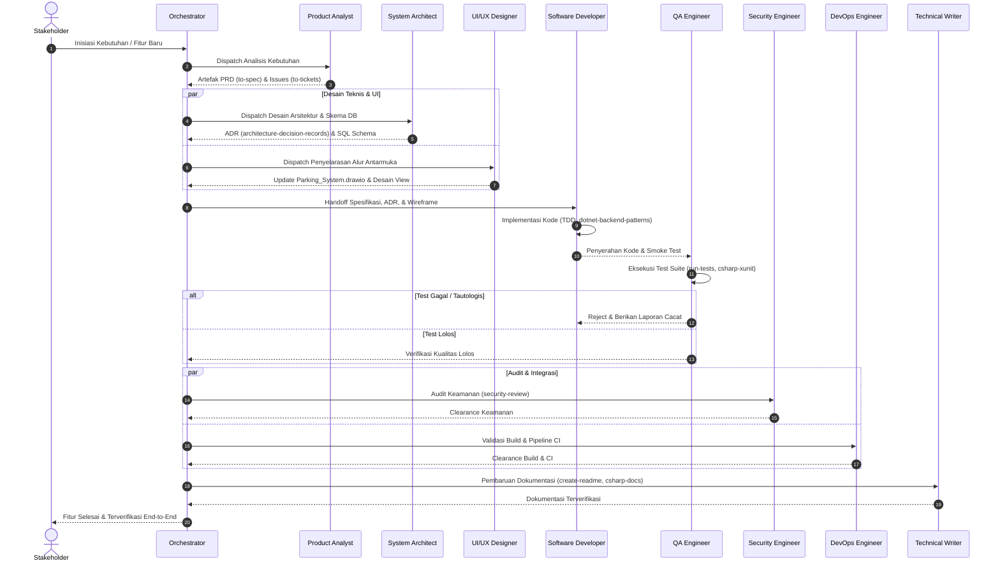

# Agent Skills Ecosystem & Governance Guide: ParkirAja (C# / .NET 10)

Dokumen ini mendefinisikan arsitektur multi-agent AI, matriks keterampilan (*skills matrix*), batasan wewenang (*boundary policies*), dan protokol jabat tangan lintas agen (*cross-agent handshake*) untuk pengembangan aplikasi **ParkirAja** (Desktop Windows Forms .NET 10 & PostgreSQL).

---

## 1. Topologi Agen & Skills Matrix

Ekosistem SDLC ParkirAja didukung oleh 9 peran agen terspesialisasi dengan keterampilan yang terisolasi dan non-redundan:

```
                          ┌────────────────────────┐
                          │      Orchestrator      │
                          └───────────┬────────────┘
                                      │
       ┌──────────────────────────────┼──────────────────────────────┐
       │                              │                              │
       ▼                              ▼                              ▼
┌──────────────┐              ┌──────────────┐              ┌──────────────┐
│Product Analyst│             │System Architect│            │UI/UX Designer│
└──────┬───────┘              └──────┬───────┘              └──────┬───────┘
       │ [PRD/Tickets]               │ [ADR/Schema]                │ [DrawIO/Theme]
       └──────────────┬──────────────┴──────────────┬──────────────┘
                      ▼                             ▼
             ┌─────────────────┐           ┌─────────────────┐
             │Software Developer│◄─────────┤   QA Engineer   │
             └────────┬────────┘ [Feedback]└─────────────────┘
                      │
       ┌──────────────┴──────────────┐
       │                             │
       ▼                             ▼
┌──────────────┐              ┌──────────────┐
│Security Eng. │              │ DevOps Eng.  │
└──────┬───────┘              └──────┬───────┘
       │                             │
       └──────────────┬──────────────┘
                      ▼
             ┌─────────────────┐
             │Technical Writer │
             └─────────────────┘
```

| Peran Agen | Global Skills Terpasang | Tanggung Jawab Utama |
|---|---|---|
| **1. Orchestrator** | `subagent-driven-development`, `dispatching-parallel-agents`, `writing-plans` | Koordinasi task DAG, manajemen dependensi antar-agen, verifikasi gate SDLC. **Dilarang keras menulis kode produksi.** |
| **2. Product Analyst** | `to-spec`, `to-tickets` | Menganalisis kebutuhan parkir (jukir, admin, tarif flat/progresif), menyusun PRD & spesifikasi, memecah user story menjadi actionable tickets. |
| **3. System Architect** | `architecture-patterns`, `architecture-decision-records`, `optimizing-ef-core-queries`, `postgresql-table-design`, `design-doc-mermaid` | Mendesain Clean Architecture, menyusun ADR, merancang skema PostgreSQL, optimasi query EF Core & pencegahan N+1 problem. |
| **4. UI/UX Designer** | `ui-ux-pro-max`, `design-system`, `drawio`, `design-doc-mermaid` | Menjaga konsistensi tema desktop WinForms (`AppTheme`, `RoundedControls`, `DarkDateTimePicker`), merawat diagram alur di `Parking_System.drawio`. |
| **5. Software Developer** | `dotnet-best-practices`, `dotnet-backend-patterns`, `csharp-async`, `test-driven-development`, `csharp-refactoring` | Mengimplementasikan service layer, repository pattern, async/await non-blocking UI thread, dan business logic parkir. |
| **6. QA Engineer** | `csharp-xunit`, `test-anti-patterns`, `run-tests`, `verification-before-completion` | Menyusun unit test xUnit, regression test, audit anti-mocking & anti-tautologi test, eksekusi test runner CLI. |
| **7. Security Engineer** | `security-and-hardening`, `email-and-password-best-practices`, `getsentry/security-review` | Audit hashing kredensial (PBKDF2/Argon2), mitigasi SQL injection pada PostgreSQL, proteksi brute force dan session management. |
| **8. DevOps Engineer** | `github-actions-templates`, `directory-build-organization` | Menyiapkan CI/CD workflow GitHub Actions untuk build dan test .NET, sentralisasi dependency versi via Central Package Management (CPM). |
| **9. Technical Writer** | `technical-writing`, `create-readme`, `csharp-docs` | Dokumentasi arsitektur di README, standardisasi XML Documentation comments pada public API/service C#, penulisan SOP operasional. |

---

## 2. Batasan Wewenang (Boundary Policies)

Setiap agen wajib mematuhi batas kewenangan berikut:

1. **Policy Orchestrator**:
   - Hanya mengontrol alur kerja, mendispatch subagent, dan memvalidasi penyelesaian task.
   - Tidak boleh mengedit kode C#, form WinForms, atau konfigurasi database secara langsung.
2. **Policy Developer vs QA Engineer**:
   - Developer tidak boleh menandai tugas selesai tanpa verifikasi smoke test atau test pass dari QA Engineer.
   - QA berhak menolak (*reject*) Pull Request / perubahan kode jika pengujian berupa tes tautologis atau tes mock kosong yang tidak menguji invariant bisnis.
3. **Policy Database & Security**:
   - Seluruh perubahan skema tabel atau indexing PostgreSQL wajib memiliki persetujuan rancangan dari **System Architect** (`postgresql-table-design`).
   - Autentikasi dan penyimpanan password wajib divalidasi oleh **Security Engineer** (`email-and-password-best-practices`) sebelum masuk ke branch produksi.
4. **Policy UI/UX**:
   - Modifikasi visual pada antarmuka WinForms wajib mempertahankan kompatibilitas layout responsif (`ResponsiveLayout.cs`) dan palet warna terpusat (`AppTheme.cs`).

---

## 3. Protokol Jabat Tangan Antar-Agen (Cross-Agent Handshake)



---

## 4. Daftar Direktori Global Skills Terpasang

Direktori penyimpanan: `C:\Users\fayak\.agents\skills\`

```
C:\Users\fayak\.agents\skills\
├── architecture-decision-records/     # Standardisasi ADR
├── architecture-patterns/             # Pola Clean Architecture & DDD
├── banner-design/                     # Aset visual & banner
├── brand/                             # Panduan identitas brand
├── caveman/                           # Komunikasi ringkas / low-token
├── create-readme/                     # Template README repository
├── csharp-async/                      # Praktik async/await aman C#
├── csharp-docs/                       # Standar XML doc comments C#
├── csharp-refactoring/                # Pola refactoring modern C#
├── csharp-xunit/                      # Panduan unit test xUnit & FluentAssertions
├── design/                            # Desain grafis & SVG
├── design-doc-mermaid/                # Diagram alur & sequence Mermaid
├── design-system/                     # Design tokens & spesifikasi UI
├── directory-build-organization/      # Directory.Build.props & CPM .NET
├── dotnet-backend-patterns/           # Service & repository patterns .NET
├── dotnet-best-practices/             # Idiom C# & modern .NET conventions
├── drawio/                            # Integrasi diagram draw.io XML
├── email-and-password-best-practices/ # Hashing PBKDF2/Argon2 & auth hardening
├── find-skills/                       # Tool penemuan agent skills
├── github-actions-templates/          # Template CI/CD GitHub Actions
├── optimizing-ef-core-queries/        # Optimasi EF Core & mitigasi query issue
├── ponytail/                          # Minimal change & anti-overengineering
├── postgresql-table-design/           # Skema & indexing PostgreSQL
├── reverse-engineer-anything/         # Analisis binary & dekompilasi
├── run-tests/                         # Eksekusi test CLI .NET
├── security-and-hardening/            # Audit keamanan & hardening kode
├── security-review/                   # Checklist security review
├── slides/                            # Presentasi HTML
├── technical-writing/                 # Struktur dokumen teknis & SOP
├── test-anti-patterns/                # Audit kualitas test suite
├── to-spec/                           # Pembuatan PRD & functional spec
├── to-tickets/                        # Pemecahan PRD ke task issues
└── ui-styling/                        # Aturan styling antarmuka
```
